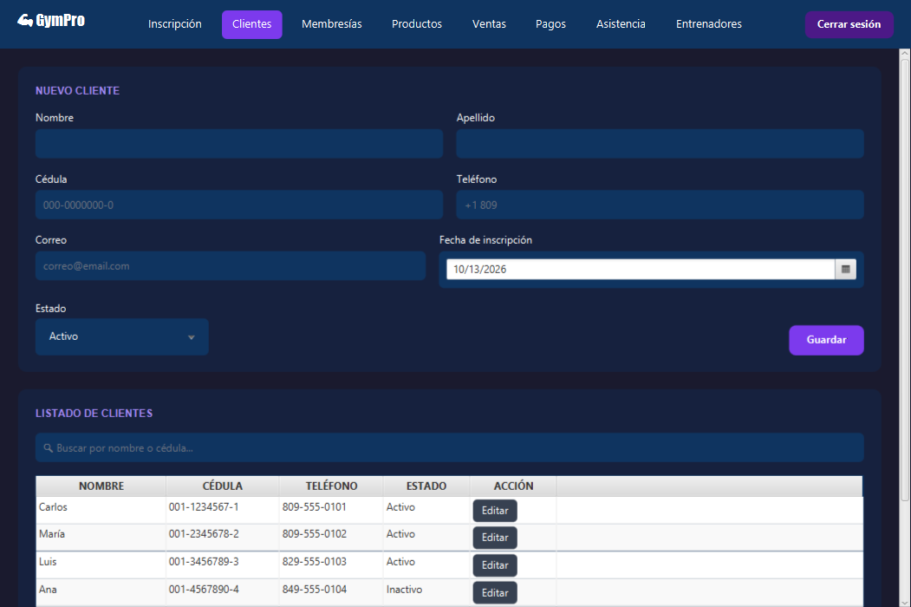
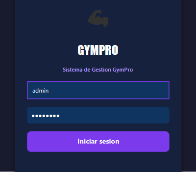
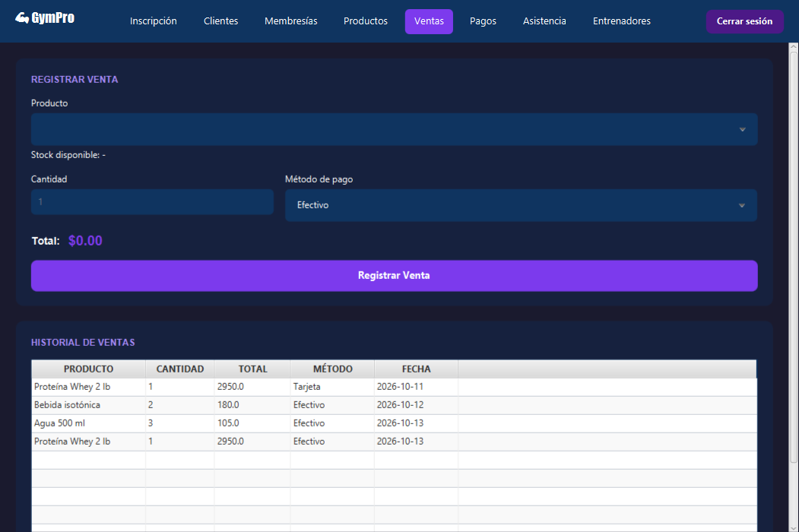
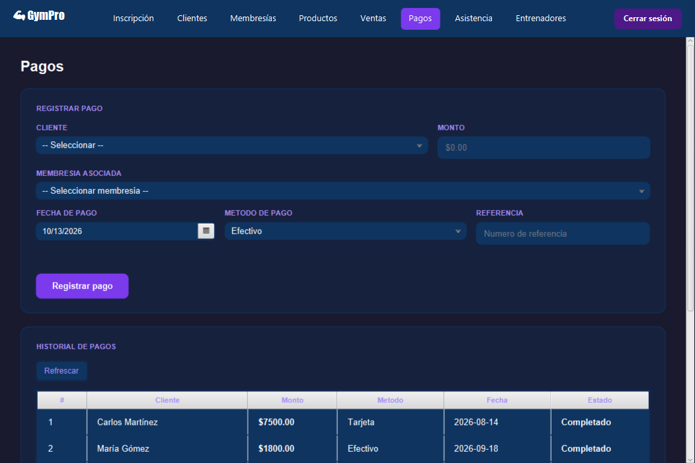
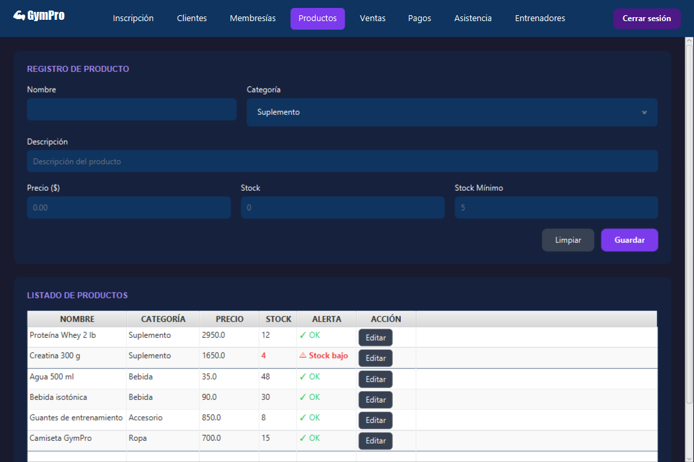
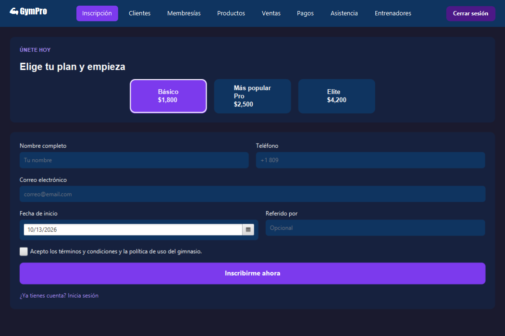
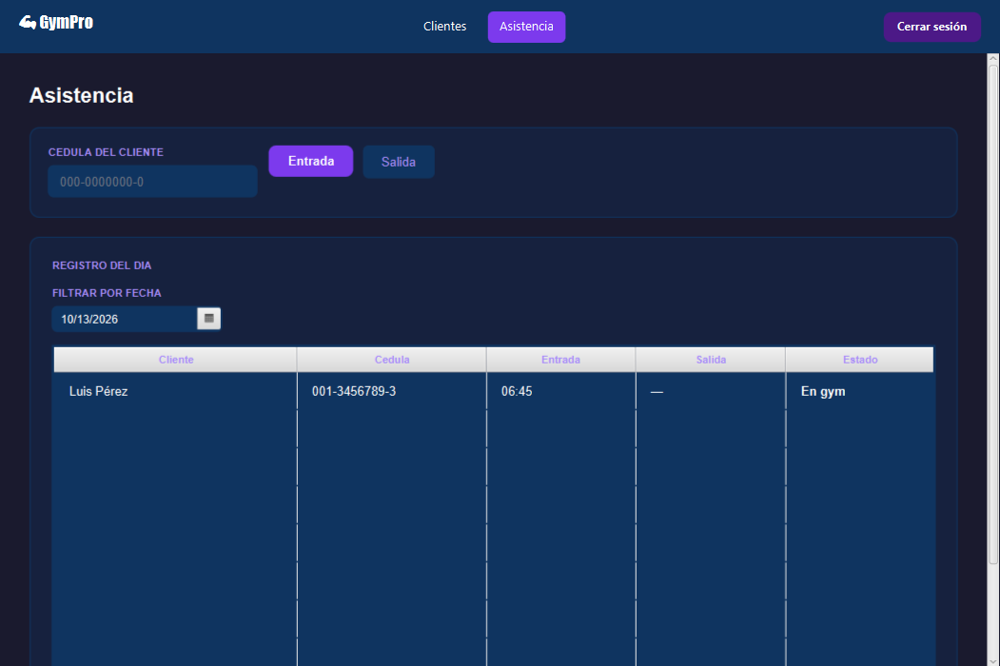

# 💪 GymPro — Sistema de Gestión de Gimnasio


*[English version below](#english)*

Aplicación de escritorio para administrar un gimnasio: clientes, membresías, pagos, control de asistencia, entrenadores e inventario con punto de venta. Incluye inicio de sesión con **control de acceso por rol**.



## Funcionalidades

| Módulo | Qué hace |
|---|---|
| **Login y roles** | Inicio de sesión contra la base de datos. El menú cambia según el rol: Administrador, Recepcionista o Entrenador. |
| **Inscripción** | Registro rápido de nuevos clientes eligiendo plan (Básico, Pro, Elite). |
| **Clientes** | Alta, edición, búsqueda por nombre o cédula y borrado lógico. |
| **Membresías** | Planes con duración, fecha de vencimiento, estado y renovación. |
| **Pagos** | Registro de pagos por cliente y membresía (efectivo, tarjeta, transferencia). |
| **Asistencia** | Entrada y salida por cédula, filtro por fecha y estado "En gym". |
| **Entrenadores** | Registro con especialidad y horario. |
| **Productos** | Inventario con alerta de stock bajo. |
| **Ventas** | Punto de venta: calcula el total, valida stock y lo descuenta automáticamente. |

| Rol | Acceso |
|---|---|
| Administrador | Todos los módulos |
| Recepcionista | Inscripción, Clientes, Membresías, Ventas, Pagos, Asistencia |
| Entrenador | Clientes, Asistencia |

## Arquitectura

Aplicación en capas, cada una con una responsabilidad:

```
ui (JavaFX)  →  service (reglas de negocio)  →  dao (JDBC)  →  MySQL
                         ↘          model (entidades)          ↙
```

- **model** — Entidades del dominio. `Persona` es una clase abstracta que heredan `Cliente` y `Entrenador`; las interfaces genéricas `Registrable<T>`, `Consultable<T>` y `Eliminable` definen el contrato de persistencia.
- **dao** — Acceso a datos con JDBC y `PreparedStatement` (evita inyección SQL). Todas las tablas usan **borrado lógico** (`activo = 0`).
- **service** — Validaciones y reglas: membresías por vencer en 7 días, descuento de stock al vender, etc.
- **ui** — Pantallas JavaFX con tema oscuro.
- **util/ConexionDB** — Lee las credenciales de variables de entorno o de `db.properties`; nunca están en el código.

## Cómo ejecutarlo

**Requisitos:** JDK 21 o superior y MySQL 8 o superior. No hace falta instalar Maven (el proyecto trae `mvnw`).

1. **Crear la base de datos** con datos de ejemplo:
   ```bash
   mysql -u root -p < database/schema.sql
   mysql -u root -p < database/seed.sql
   ```
   (También puedes abrir los dos archivos en MySQL Workbench y ejecutarlos.)

2. **Configurar la conexión:** copia `db.properties.example` como `db.properties` y pon tu usuario y contraseña de MySQL.
   También puedes usar las variables de entorno `GYM_DB_URL`, `GYM_DB_USER` y `GYM_DB_PASSWORD`.

3. **Ejecutar:**
   ```bash
   ./mvnw javafx:run
   ```
   En Windows (CMD o PowerShell): `mvnw.cmd javafx:run`

### Usuarios de prueba

| Usuario | Contraseña | Rol |
|---|---|---|
| `admin` | `admin123` | Administrador |
| `recepcion` | `recepcion123` | Recepcionista |
| `entrenador` | `entrenador123` | Entrenador |

## Capturas

| Login | Ventas |
|---|---|
|  |  |

| Pagos | Productos |
|---|---|
|  |  |

| Inscripción | Menú del rol Entrenador |
|---|---|
|  |  |

## Hoja de ruta

- [x] Integrar todos los módulos en `main` y migrar a Maven
- [x] Script de base de datos y datos de ejemplo
- [x] Credenciales fuera del código
- [ ] Contraseñas con hash (BCrypt) — hoy se guardan en texto plano
- [ ] Mostrar los errores de base de datos en la interfaz en vez de la consola
- [ ] Membresías: permitir elegir el cliente al asignar (hoy falla porque no hay selector)
- [ ] Inscripción: crear también la membresía del plan elegido
- [ ] Pruebas unitarias con JUnit para la capa `service`
- [ ] Integración continua con GitHub Actions

## Créditos

Proyecto iniciado en equipo como trabajo universitario (marzo–abril 2026):

- **Yojairo Rodríguez** ([@yojairoivan-sketch](https://github.com/yojairoivan-sketch)) — Modelo de dominio (`Persona`, interfaces y entidades). Mantiene y continúa el proyecto.
- **Shantal** — Capa DAO y conexión a la base de datos.
- **Welinton** — Capa de servicios y validaciones de negocio.
- **Loadi** — Pantallas de Clientes, Inscripción, Membresías, Productos y Ventas.
- **Jamilet** — Login, pantallas de Pagos, Asistencia y Entrenadores, y hojas de estilo.

El historial completo de commits del equipo se conserva en este repositorio.

---

<a id="english"></a>

## English

**GymPro** is a desktop application for managing a gym: members, memberships, payments, attendance tracking, trainers, and inventory with a point of sale. It includes login with **role-based access control** (Administrator, Receptionist, Trainer).

**Tech stack:** Java 21, JavaFX 21, MySQL, JDBC, Maven.

**Architecture:** layered design — `ui` (JavaFX) → `service` (business rules) → `dao` (JDBC with prepared statements) → MySQL, sharing a `model` layer built around an abstract `Persona` class and generic persistence interfaces. All tables use soft deletes.

### Quick start

Requirements: JDK 21+ and MySQL 8+. Maven is not required (the wrapper `mvnw` is included).

```bash
mysql -u root -p < database/schema.sql
mysql -u root -p < database/seed.sql
cp db.properties.example db.properties   # then edit your MySQL user/password
./mvnw javafx:run                        # Windows: mvnw.cmd javafx:run
```

Demo users: `admin / admin123`, `recepcion / recepcion123`, `entrenador / entrenador123`.

The UI and code are in Spanish. The project started as a university team assignment and is now maintained by [@yojairoivan-sketch](https://github.com/yojairoivan-sketch); see the roadmap above for planned improvements (password hashing, unit tests, CI).
